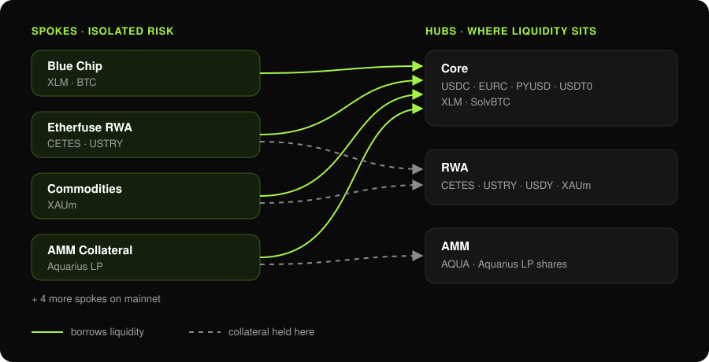

# XOXNO Lending

[](https://github.com/XOXNO/rs-lending-xlm/actions/workflows/tests.yml)

**A modular money market on Stellar.** Deposit once, and every spoke built on
top can borrow it. New assets plug into existing liquidity from day one, with
risk capped and isolated per spoke.

Live on Stellar mainnet · [xoxno.com](https://xoxno.com) ·
[contact@xoxno.com](mailto:contact@xoxno.com)

## Why

On Stellar today, a new asset gets a new lending pool that starts empty. Its
holders cannot borrow from the liquidity that already sits in USDC or XLM
pools. XOXNO Lending separates where liquidity sits from where risk is taken:

- **Deposit once.** Suppliers lend into one book per asset and earn interest
  from every spoke that borrows it.
- **Isolated risk.** Each spoke has its own collateral factors, borrow caps
  and halt flags. A problem in one spoke stays inside its caps.
- **Launch faster.** A new asset needs a listing, not a new pool. It borrows
  existing depth from the first block.

## How it works



- A **hub** holds liquidity: one book per asset, with its own interest rate.
- A **spoke** is a risk profile. It lists hub assets as collateral or debt,
  each with its own LTV, liquidation threshold and caps.
- Example: a spoke for tokenized equities could accept TSLA at 60% LTV and cap
  USDC borrowing at $10M of a $100M Core book. That cap limits what Core
  lenders have at risk in the spoke.

Users call the **controller**. It checks account risk, reads prices from the
**price aggregator**, and moves tokens in the **pool**, which holds every
token. Each account is a **position NFT**. **Governance** owns the protocol
behind a timelock. Mainnet runs [three hubs and eight spokes](skills/xoxno-lending/addresses.md).

## Features

| Feature | What you get |
|---|---|
| One-transaction strategies | Leverage (`multiply`), debt and collateral swaps, repay with collateral, and migration from Blend, each in a single transaction |
| Flash loans | Borrow pool cash for one call; repay with a fee in the same call |
| Composable prices | Chainlink, RedStone, Reflector and XOXNO feeds, plus Aquarius and Curve LP pricing; dual-source prices must agree |
| Liquidations | A bonus curve pays liquidators; bad debt is shared only by the lenders of the affected hub asset |
| Safe governance | Typed proposals behind a tiered timelock; a guardian can only reduce risk |
| Delegated curation | Partners can run their own hubs and spokes through the curator contract |
| Formal verification | Certora rules and Lean proofs check the core math, accounting and liquidation logic |

## Work with us

| You are | You can |
|---|---|
| An asset issuer | List your RWA as collateral in a spoke |
| An institution | Run your own hub or spoke |
| A wallet | Add an "Earn" feature on top of the hubs |
| A liquidity provider | Supply to a hub and earn from every spoke |
| A developer | Integrate with the [skills](skills/README.md), SDK and [endpoint reference](docs/reference/endpoints.md) |

## Audits

Runtime Verification audited the core contracts and `common/` at `a2486b25`
(`v1.1.0`) in November 2026; see the
[report](audits/2026-11-runtime-verification.pdf) and
[SECURITY.md](SECURITY.md#audits).

## Deployments

Mainnet and testnet [contract addresses and ids](skills/xoxno-lending/addresses.md)
are generated from [`configs/networks.json`](configs/networks.json). These
documents describe this source tree: before you deposit funds, compare the
deployed WASM hashes in `configs/networks.json` with your own build.

## Documentation

Start with [Architecture](docs/reference/architecture.md).

| Question | Reference |
|---|---|
| Components, authority, custody | [Architecture](docs/reference/architecture.md) |
| Attacks, trust assumptions, residual risks | [Threat model](docs/explanation/threat-model.md) |
| Safety properties | [Invariants](docs/reference/invariants.md) |
| Units, rounding, interest, risk, numeric limits | [Formulas](docs/reference/formulas.md) |
| Design rationale | [Design decisions](docs/explanation/decisions.md) |
| Callable surface and authorization | [Endpoints](docs/reference/endpoints.md) |
| Event payloads and indexing | [Events](docs/reference/events.md) |
| Failure codes and causes | [Errors](docs/reference/errors.md) |
| Operator procedures | [Freeze a listing](docs/reference/runbooks/freeze-a-listing.md), [force-socialize bad debt](docs/reference/runbooks/force-socialize-bad-debt.md) |
| Formal verification | [Certora](certora/README.md), [Aeneas proofs](verification/aeneas/README.md) |
| Integration guides for agents and SDK users | [Skills](skills/README.md) |
| Per-contract detail | `contracts/<name>/README.md` |

## Development

Install the Rust toolchain and targets in [rust-toolchain.toml](rust-toolchain.toml)
and the Stellar CLI. Build the WASM contracts before you run tests.

```sh
git clone https://github.com/XOXNO/rs-lending-xlm.git
cd rs-lending-xlm
make build
make test
```

| Task | Command |
|---|---|
| Run the integration harness only | `make test-harness` |
| Check formatting / lint | `make fmt-check` / `make clippy` |
| Check documentation links and symbols | `make docs-check` |
| List every target | `make help` |

| Path | Contents |
|---|---|
| `contracts/` | Deployable contracts |
| `common/`, `interfaces/` | Shared math, types and client interfaces |
| `tests/`, `certora/`, `verification/` | Tests, fuzzers and formal proofs |
| `services/` | Keeper and metrics exporter, in separate workspaces |

Read [CONTRIBUTING.md](CONTRIBUTING.md) before you open a pull request.

## Security and license

Report vulnerabilities privately through [SECURITY.md](SECURITY.md), not in a
public issue. Rewards are paid through the
[XOXNO bug bounty on Immunefi](https://immunefi.com/bug-bounty/xoxno/information/).

Licensed under [PolyForm Noncommercial 1.0.0](LICENSE). Commercial use requires
a written agreement with XOXNO.
